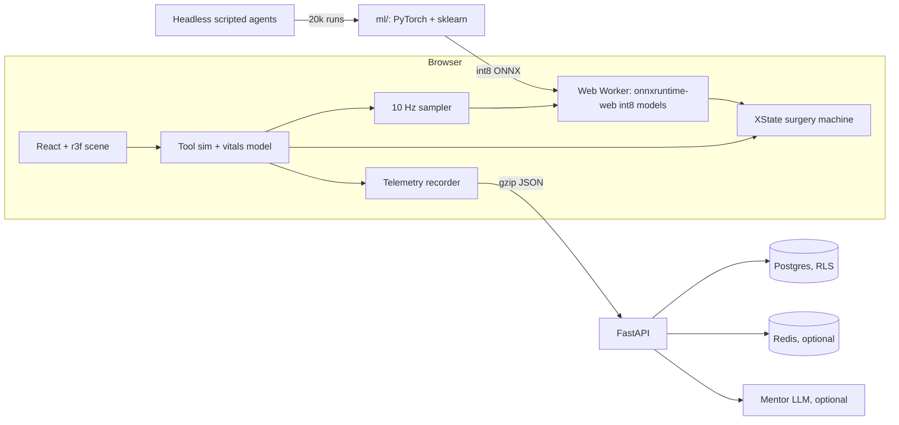

# NeuroClip

A browser-based, educational brain aneurysm clipping simulator. You work through a six-step pterional approach under a simulated operating microscope, with ten tools, a live vitals monitor, a mentor, a server-scored debrief and a leaderboard.

> **Educational use only.** NeuroClip is not a medical device, uses no patient data and must not guide any clinical decision. The physiology is simplified and partly invented.


## Play

```powershell
pnpm install
pnpm dev
```

Open http://localhost:5173. Pass `?intro=0` to skip the scrub-in intro. The API is optional: without it the run still plays, and only saving a run and the leaderboard need it.

## What is in it

- **Scene.** Procedural wet-looking brain with heart-rate pulsation, a vessel tree and an MCA aneurysm, a circular microscope aperture, wheel zoom 1-4x, a focus slider with depth of field, and a Shift fine mode. Three anatomy variants come from the run seed.
- **Tools.** Ten tools on keys 1-0, each with visible effects and failure rules.
- **Steps and mentor.** An XState machine for six steps, a checklist rail, a mentor caption bar with optional speech, and Guided, Expert and Emergency modes. Emergency starts with an aneurysm rupture.
- **Vitals.** HR, BP, SpO2 and ICP respond to blood loss and tool errors, with alarms and a monitor beep. Suction and bipolar recover a rupture.
- **Backend.** FastAPI sessions, gzip telemetry, server-side scoring (the client score is never trusted), debrief, leaderboard, rate limits and a mentor stream with scripted fallback.
- **ML.** A skill estimate and a rupture-risk warning, both running in a Web Worker at 10 Hz.
- **Polish.** Scrub-in intro, tool and clip sounds, a result card (PNG), a last-15-seconds replay export (GIF), settings for reduced motion, skipping blood and a colorblind palette, and a References page at `#/references`.

## Architecture



The same TypeScript code builds training windows (headless agents driving the real simulation) and live windows in the browser, so features cannot drift apart.

## Results

Models were trained on 20,000 simulated runs from 40 virtual users (58,578 windows). They learned the scripted agents' style, not real surgical skill, and nothing here is validated on people.

| Task | Model | CV | AUC | F1 | Other | Size | Median latency |
|---|---|---|---|---|---|---|---|
| Skill (expert vs not) | GBM baseline | leave-one-user-out (40 folds) | 0.963 | 0.847 | MAE 0.107 | n/a | n/a |
| Skill (expert vs not) | 1D-CNN + GRU | leave-users-out (8 folds) | 0.966 | 0.854 | MAE 0.103 | 0.08 MB | 0.98 ms |
| Rupture risk (10 s) | GBM baseline | leave-one-user-out (40 folds) | 0.876 | 0.583 | ECE 0.015 | n/a | n/a |
| Rupture risk (10 s) | LSTM | leave-users-out (8 folds) | 0.877 | 0.583 | ECE 0.014 | 0.03 MB | 0.21 ms |

Latency is Python on CPU. In the browser the worker reported about 2.6 ms for both models together with the page visible. Details and model cards are in [ml/README.md](ml/README.md).

## Performance

- Scene: 15-18 draw calls and 125-145 fps on the development machine. The budget is under 150 draw calls and 60 fps. There are no GLB assets, so the GLB size budget does not apply.
- Production build: app JS 1.27 MB (361 KB gzip), CSS 3.6 KB gzip. The onnxruntime wasm is 14.8 MB and loads in the worker. The int8 models total 356 KB.

## Develop

```powershell
pnpm lint
pnpm typecheck
pnpm test
pnpm e2e
```

API, from `apps/api`: `python -m venv .venv`, `pip install -e ".[dev]"`, `pytest`, `alembic upgrade head`, `uvicorn app.main:app --reload`. ML is described in [ml/README.md](ml/README.md). Copy `.env.example` to `.env` for local settings and never commit secrets.

## Deploy

See [docs/DEPLOY.md](docs/DEPLOY.md) for the Vercel (web) and Fly.io (API) steps. The config files are ready but have not been run against real accounts.

## Known limits

- No real 3D assets: the brain and vessels are procedural.
- Row-level security, Redis and the live LLM mentor are untested against real services.
- The layout targets desktop screens and is poor on narrow ones.
- The replay GIF records the last 15 seconds of the rendered view, not a deterministic re-simulation.

## More

Architecture, API, scoring and ML pipeline notes for contributors are in [docs/DEVELOPMENT.md](docs/DEVELOPMENT.md).
